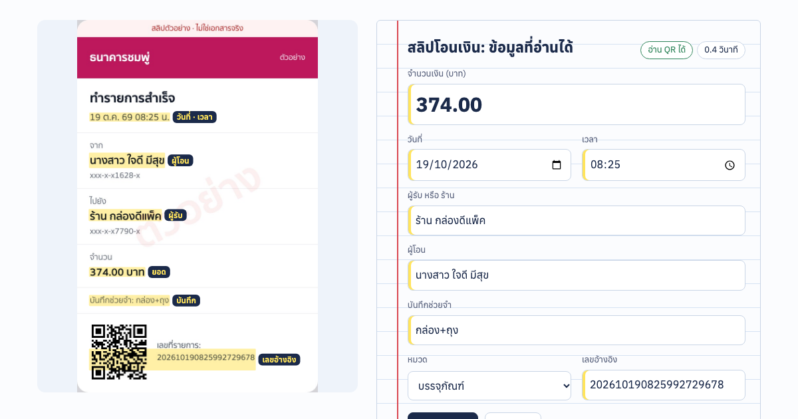

# SlipSheet

อ่านสลิปโอนเงินและใบเสร็จภาษาไทยในเบราว์เซอร์ แล้วลงบัญชีให้ ได้ยอดเงิน วันที่ เวลา ผู้รับ/ร้าน ผู้โอน บันทึกช่วยจำ และเลขอ้างอิง พร้อมจัดหมวดค่าใช้จ่ายให้ ก๊อปไปวางใน Google Sheets หรือดาวน์โหลด CSV ได้

**ลองเลย:** https://slipsheet-th.vercel.app



- **ฟรีทั้งหมด** ไม่ใช้ API ที่ต้องจ่ายเงิน และไม่มีเซิร์ฟเวอร์
- **รูปไม่ออกจากเครื่อง** OCR รันในเบราว์เซอร์ (Tesseract, ภาษาไทยและอังกฤษ)
- **อ่าน QR บนสลิป** (jsQR) เพื่อเอาเลขอ้างอิงที่แม่นกว่า OCR และตรวจ CRC ของ QR
- **กันรายการซ้ำ** เมื่อเลขอ้างอิงตรงกัน หรือยอด วันที่ และเวลาตรงกัน
- ลงหลายรูปพร้อมกันได้ ลากวาง เลือกไฟล์ หรือวางจากคลิปบอร์ด (Ctrl+V)

> เว็บนี้เป็นตัวอย่างเพื่อแสดงผลงาน สลิปตัวอย่างทั้งหมดเป็นของ **ธนาคารและร้านสมมติ** (ธนาคารหินอ่อน ธนาคารชมพู่ ธนาคารกาแฟ) และมีลายน้ำ "ตัวอย่าง" ทุกใบ

## ความแม่น

วัดด้วย `npm run eval` จากเอกสารตัวอย่าง 40 ใบ (สลิป 30 ใบ ใบเสร็จ 10 ใบ; แคปหน้าจอ 23 ใบ ภาพถ่ายเอียง เบลอ และบีบอัด 17 ใบ) ด้วยโค้ดเดียวกับหน้าเว็บ ผลเต็มอยู่ใน [`public/eval.json`](public/eval.json)

| ข้อมูล | ถูกทุกตัวอักษร |
|---|---|
| จำนวนเงิน | 40/40 |
| วันที่ | 38/40 |
| เวลา (สลิป) | 30/30 |
| เลขอ้างอิง (สลิป มี QR) | 30/30 |
| หมวด | 38/40 |
| ผู้รับ / ร้าน | 35/40 (อีก 5 ใบต่างกันไม่เกิน 1–2 ตัวอักษร เช่น วรรณยุกต์หาย) |
| ผู้โอน | 28/30 |
| บันทึกช่วยจำ | 20/25 |

อ่านใบละประมาณ 0.35 วินาทีบน MacBook (M-series)

ข้อจำกัด:
- ชุดทดสอบเป็นสลิปที่สร้างขึ้นเอง (`tools/make-samples.mjs`) สลิปจริงของแต่ละธนาคารหน้าตาต่างกัน งานจริงควรวัดกับสลิปของร้านนั้นก่อน
- ชื่อภาษาไทยอาจมีวรรณยุกต์หาย และคำสั้นตัวเล็กอาจอ่านพลาด จึงมีฟอร์มให้ตรวจแก้ก่อนลงบัญชีเสมอ
- เลขที่ใบเสร็จที่ขึ้นต้นด้วยตัว R บางครั้งถูกอ่านเป็นเลข 9
- การอ่าน QR ไม่ได้ตรวจกับธนาคารว่าสลิปจริงหรือปลอม ถ้าต้องตรวจจริงต้องใช้บริการตรวจสลิปแบบเสียเงิน

## โครงสร้าง

```
public/            เว็บ (static, deploy ทั้งโฟลเดอร์)
  index.html, style.css, app.js
  lib/parser.js    แยกข้อมูลจากบรรทัด OCR (ใช้ทั้งในเบราว์เซอร์และ Node)
  lib/qr.js        อ่าน/สร้าง QR บนสลิปแบบ TLV + CRC-16
  samples/         สลิปและใบเสร็จตัวอย่าง + truth.json (คำตอบที่ถูก)
  eval.json        ผลวัดความแม่นล่าสุด
tools/
  make-samples.mjs สร้างเอกสารตัวอย่างด้วย Playwright
  eval.mjs         วัดความแม่น (OCR + QR + parser เหมือนหน้าเว็บ)
  make-og.mjs      สร้างภาพ og.png จากหน้าเว็บจริง
test/              unit tests ของ parser และ QR
```

## รันเอง

```bash
npm install
npm test                         # unit tests
npm run eval                     # วัดความแม่น เขียน public/eval.json
python3 -m http.server 8765 -d public   # เปิด http://localhost:8765
```

## ต่อยอดได้

- รับสลิปจาก LINE OA แล้วบันทึกลง Google Sheets อัตโนมัติ พร้อมสรุปรายจ่ายรายวัน
- ใช้ AI อ่านใบกำกับภาษีที่หน้าตาซับซ้อน (เลขผู้เสียภาษี VAT รายการสินค้า)
- ตรวจสลิปปลอมกับธนาคารผ่านบริการตรวจสลิป

สนใจทำแบบนี้ให้ร้านของคุณ: [Fastwork](https://fastwork.co/user/chasvitf) · [chanavee.vercel.app](https://chanavee.vercel.app)

## เครดิต

- [Tesseract.js](https://github.com/naptha/tesseract.js) (Apache-2.0) และข้อมูลภาษาไทยของ Tesseract โหลดจาก jsDelivr
- [jsQR](https://github.com/cozmo/jsQR) (Apache-2.0)
- ฟอนต์ [Anuphan](https://fonts.google.com/specimen/Anuphan) (OFL)

โค้ดในรีโปนี้ใช้สัญญาอนุญาต MIT
